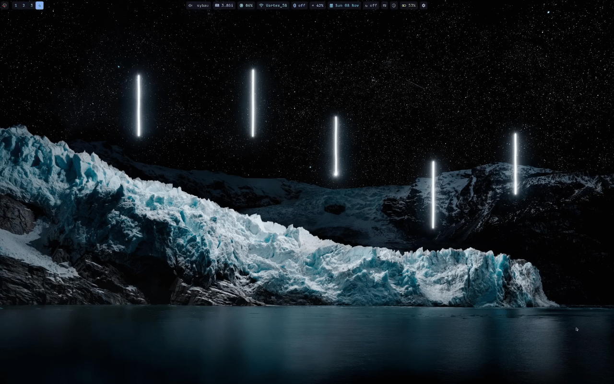

# Derg-popup

This is a fun little spontaneous project I've originally put together in the span of two days. It is intended to be a popup window that displays the current time in a fancy whip of motion, telling the time for a brief moment.

Even though it's not some superpowered tool, I've been maintaing it for more than a year now, mainly because I use it on a daily basis. The second reason is that zig tends to introduce breaking changes every new release and I try to keep up with that. 

Currently, it has these two flavors:

- A popup window taking up about a nineth of your screen, telling the time, with a sleeping derg sprawled on top of it.
- Same as the first one but telling useful info about battery percentage.

The two flavors are distributed as separate executables but with shared dependencies.

I highly suggest you configure your window manager and compositor to leave this window out of any open/close animations, shadows, blur, focus, etc. Those effects unfortunatelly get in the way of the promised clean look, which the popup window manages on its own.

## License

Code is MIT licensed. All files in [assets/](assets/), unless explicitly equipped with a different license, are © 2025 by ZenithCrow, licensed under [CC-BY-4.0](https://creativecommons.org/licenses/by/4.0/).

## Installation

### Windows

[Grab the latest release (.zip portable version)](https://github.com/ZenithCrow/derg-clock-popup/releases/latest) or [build from source](#build-from-source) (this one is quite tedious on Windows)

### Linux

**Works on both Wayland and X11 thanks to SDL3! yayy**

The only downside of this compatibility is the popup not being able to render atop fullscreen windows, since it is just a regular window.

If you're using Arch, there is an [AUR package](https://aur.archlinux.org/packages/derg-clock-popup). (this package currently only contains the clock popup)

Otherwise, let's [build from source](#build-from-source), my friend!

## Build from source

Tool prequisities: `zig 0.17`.

### Dependencies

#### SDL3

The best way to get started is to install SDL3 libraries system-wide, namely `SDL3`, `SDL3_ttf`, `SDL3_image`. Arch example:

    pacman -S sdl3 sdl3_ttf sdl3_image

Sometimes their respective 'devel' variants (`SDL3-devel`) might be needed because of missing headers. e.g. on Void linux:

    xbps-install SDL3-devel SDL3_ttf-devel SDL3_image-devel

In scenarios where the libraries aren't accessible in standard system search paths (`/usr/lib`), you can point the `-Dsdls_lib_path` build option to the directory containing the SDL libraries, as well as point the `-Dsdls_include_path` build option to the parent directory of the SDL include directories. For example if `SDL3.h` is in `foo/SDL3/SDL3.h`, the options looks like: `-Dsdls_include_path=foo`.

The same thing works for Windows too. But why are you building this from source on Windows? 

### Install prefix

On Linux, the preferred prefix to install from source is to `/usr/local` for system-wide and to `$HOME/.local` for a single user. You can use the `--prefix` build option to specify where to install the program (the executable itself will end up at `{prefix}/bin/`).

The corresponding Windows prefixes are `"C:\Program Files"` and `%LOCALAPPDATA%`

Most of the time, This snippet suffices. 

    zig build --release=safe --prefix /usr/local

However, if you find yourself battling the library and include search path or want to install only one of the popups, use this one below as was explained above. Replace `{}` with your specific values. `[]` is optional.

    zig build --release=safe --prefix {your_prefix} [-Dpopup-variant=clock|battery] [-Dsdls_lib_path={your_sdls_lib_path}] [-Dsdls_include_path={your_sdls_include_path}]

